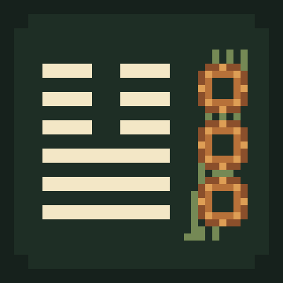

# 圖示與材質來源

錢幣與籌策物品圖示使用內建 image_gen 工具產生（generate、transparent_background=true），再以最近鄰取樣匯出為 32 × 32 PNG 遊戲材質；保留透明背景。原始三個圖示各自生成，木、鐵、金與銅綠的單錢／三錢則由一次生成的 2 欄 × 4 列透明素材表技術切分。未使用外部付費 API，也未複製 Minecraft 的圖片。

本專案新增圖示依 MIT 授權提供，見根目錄 LICENSE。

## 最終材質

- [three_coins.png](../src/main/resources/assets/yigua/textures/item/three_coins.png)
- [yarrow_stalks.png](../src/main/resources/assets/yigua/textures/item/yarrow_stalks.png)
- [copper_coin.png](../src/main/resources/assets/yigua/textures/item/copper_coin.png)
- [wooden_coin.png](../src/main/resources/assets/yigua/textures/item/wooden_coin.png)
- [wooden_three_coins.png](../src/main/resources/assets/yigua/textures/item/wooden_three_coins.png)
- [iron_coin.png](../src/main/resources/assets/yigua/textures/item/iron_coin.png)
- [iron_three_coins.png](../src/main/resources/assets/yigua/textures/item/iron_three_coins.png)
- [gold_coin.png](../src/main/resources/assets/yigua/textures/item/gold_coin.png)
- [gold_three_coins.png](../src/main/resources/assets/yigua/textures/item/gold_three_coins.png)
- [green_copper_coin.png](../src/main/resources/assets/yigua/textures/item/green_copper_coin.png)
- [green_copper_three_coins.png](../src/main/resources/assets/yigua/textures/item/green_copper_three_coins.png)

三種竹籌外觀沿用 yarrow_stalks.png，以 Minecraft 原生 constant tint 區分藤綁、烤製線綁與烤製藤綁。木籌與草籌亦沿用此材質，各以木棕與淡黃綠的 constant tint 呈現；原 PNG 未重新繪製，透明背景維持不變。

## 卦象與狀態圖示

六十四卦的成就圖示是程式繪製的原創透明 PNG，依核心六爻遮罩自下而上畫出陽爻的完整筆畫與陰爻的兩段筆畫。生成與驗證入口為 [generate_advancement_assets.py](../tools/generate_advancement_assets.py)，圖示位於 `src/main/resources/assets/yigua/textures/item/hexagram_XX.png`；未複製原版圖示，依本專案 MIT 授權提供。

狀態效果圖示使用 [gui.json](../src/main/resources/assets/minecraft/atlases/gui.json) 的原生圖集別名，將本模組的效果識別名稱對應至遊戲安裝中的 `minecraft:mob_effect/...` 圖示。生成與驗證入口為 [generate_effect_assets.py](../tools/generate_effect_assets.py)。模組封裝只提供圖集定義與語系名稱，沒有打包或重新授權 Minecraft 的圖示像素；遊戲原有素材仍依其原授權使用。

## 太極旋轉圖示

[taiji_tool.png](../src/main/resources/assets/yigua/textures/item/taiji_tool.png) 是 [generate_taiji_assets.py](../tools/generate_taiji_assets.py) 以黑白圓形、圓弧與反向旋轉取樣繪製的原創圖示。32 個不同的 16×16 影格排列成 16×512 透明 PNG；原生 `.png.mcmeta` 每格 5 個遊戲刻、不插值，正常 20 TPS 時約八秒轉一圈。生成器同時產生原生動畫設定、物品模型及物品定義共四個檔案，`--check` 只讀回核對。

圖示像素不取自影像生成模型、下載圖或 Minecraft 圖片；生成程式由生成式 AI 編寫，沒有宣稱為人工繪製。圖示與生成器依本專案 MIT 授權提供，保留 `poplolioi11` 署名。PNG SHA256：`4768076c19b08f54f50c3ef3c7dc07de81d044a1bc814cb7e859960ee9d89375`。素材核對不代表太極玩法或多人驗收已完成。

## 發布頁專案圖示



[400×400 專案圖示](media/project-icon-400.png) 與 [40×40 縮小預覽](media/project-icon-40.png) 由 [generate_listing_assets.py](../tools/generate_listing_assets.py) 以 Python 標準函式庫產生。六爻筆畫直接讀取核心第十一卦「泰」的遮罩，初爻在下，陽爻完整、陰爻分兩段；搭配三枚原創方孔錢與籌策幾何。畫面在 40×40 邏輯像素格繪製，整數最近鄰放大至 400×400。

沒有輸入圖片、字型、下載素材、Minecraft 商標或遊戲圖示。構圖與生成程式由生成式 AI 編寫，像素由程式確定計算；不稱為人工繪製或把程式繪圖當作平台 AI 政策豁免。圖示是專案識別圖，不是遊戲截圖，也不表示起卦一定得到泰卦或正面效果。

此素材供 CurseForge／Nexus 提交時作為候選圖示，依 MIT 提供並保留 `poplolioi11 / 一卦 yigua.art` 署名；是否接受由平台審核。不宣稱符合 Modrinth 圖示政策，也不以此規避該平台的 AI 披露或上架限制。發布平台註記見 [PLATFORM_DESCRIPTIONS.md](PLATFORM_DESCRIPTIONS.md)。

2026-10-11 已讀回 400×400 圖與縮小預覽，確認六爻、三枚方孔錢與籌策可辨識。來源與 SHA256 保存於 [listing-assets.json](media/listing-assets.json)；400×400 PNG SHA256：`82f354bfe556084986ac20120ceda3c65353f6de81c6e19d7b4dd33950bc2315`。

重現與只讀核對：

```sh
python3 tools/generate_listing_assets.py
python3 tools/generate_listing_assets.py --check
python3 tools/generate_taiji_assets.py --check
```

## 最終提示詞

### three_coins

~~~text
Use case: stylized-concept. Asset type: Minecraft inventory item pixel-art sprite for a Chinese I Ching divination mod. Create one single icon showing exactly THREE ancient Chinese copper cash coins with clearly square holes, clustered in a small triangular overlapping group, each coin still recognizable. Warm orange copper, deep brown outline, bright copper highlights, consistent upper-left light. True crisp low-resolution pixel art with chunky square pixels on a strict 32 by 32 logical pixel grid, no smooth curves, no antialiasing, no gradients. Scale the pixel art evenly to fill a square output image; centered with 2 logical pixel margin. Genuine transparent background. No text, no lettering, no labels, no decorative surround, no Minecraft brand logo, no photorealism, no ingots. This is a functional game item icon for three-coin divination, visually readable at 32x32.
~~~

### 木、鐵、金與銅綠錢素材表

模式：內建 image_gen，generate、transparent_background=true。素材表一次生成；匯出時依各欄透明間隔切分八個圖示，保留原圖顏色與透明背景，以最近鄰縮至 28 像素以內並補透明邊界至 32 × 32。

~~~text
Use case: stylized-concept.
Asset type: one original Minecraft inventory pixel-art sprite sheet for a Chinese I Ching divination mod.
Primary request: create ONE transparent portrait sheet, arranged as exactly TWO equal-width columns and FOUR equal-height rows, eight clearly separated icon cells. The sheet has aspect ratio 1:2; each logical cell is square, 32x32 logical pixels, and the entire logical sheet is 64x128. All grid lines, labels and borders are invisible. Each sprite is centered in its own cell with at least 3 logical pixels of transparent margin so technical grid slicing is safe.
Layout:
Row 1 wood: left ONE wooden cash coin, right exactly THREE wooden cash coins overlapping in a small triangular group.
Row 2 iron: left ONE iron cash coin, right exactly THREE iron cash coins overlapping in the same triangular arrangement.
Row 3 gold: left ONE golden cash coin, right exactly THREE golden cash coins in the same triangular arrangement.
Row 4 green patinated copper: left ONE green copper cash coin, right exactly THREE green copper cash coins in the same triangular arrangement.
Subject: ancient Chinese round cash coins with LARGE square holes. The square holes are genuinely transparent, not painted black. Each coin is clearly round and has no writing, letters or symbols. Single coins face the viewer. Three-coin groups keep all three coin outlines recognizable.
Style: crisp chunky low-resolution pixel art, consistent strict square pixel grid, limited palettes, dark outlines, upper-left highlights. No antialiasing, no smooth vector curves, no gradients. Upscale the logical sprite sheet evenly for output while preserving the pixel art look.
Materials and colors: wood warm medium brown with subtle wood-grain pixels; iron clearly neutral SILVER GRAY with bright gray highlights, NO brown or orange hue; gold rich yellow gold with golden highlights; green copper visibly turquoise/verdigris green patina with deep green outlines. Use consistent shapes and lighting across materials.
Background: actual alpha transparency across the entire sheet, all spacing and all holes. No checkerboard, no canvas, no card panels, no visible grid, no shadow outside sprite bounds.
Avoid: text, captions, rows with extra icons, missing icons, coins straddling cell boundaries, ingots, nuggets, foliage, logos, watermark, photorealism, branded Minecraft artwork.
This is a single production sprite sheet. Exact fixed 2-column by 4-row arrangement is essential.
~~~

### yarrow_stalks

~~~text
Use case: stylized-concept. Asset type: Minecraft inventory item pixel-art sprite for a Chinese I Ching divination mod. Create one single icon of a BUNDLE of slim divination counting stalks, about seven thin straight bamboo or yarrow-like rods, diagonally bottom-left to top-right, tied at the middle with one dark brown cord. Show individual ends, mostly warm tan and muted olive green, deep brown outlines, subtle light tan highlights upper-left. The bundle must look like slender counting sticks rather than thick growing bamboo trunks, leaves, a broom or wheat. True crisp low-resolution pixel art with chunky square pixels on a strict 32 by 32 logical pixel grid, no smooth curves, no antialiasing, no gradients. Scale evenly to fill square output; centered with 2 logical pixel margin. Genuine transparent background. No text, no lettering, no labels, no decorative surround, no Minecraft brand logo, no photorealism. Functional game item icon for bamboo substituted yarrow divination, clearly readable at 32x32.
~~~

### copper_coin

~~~text
Use case: stylized-concept. Asset type: Minecraft inventory crafting ingredient pixel-art sprite for a Chinese I Ching divination mod. Create one single icon showing ONE ancient Chinese copper cash coin, face-on, with a large clearly square hole through its center. Warm orange copper, deep brown outline, bright copper highlights with upper-left lighting. No writing or symbols on the coin. True crisp low-resolution pixel art with chunky square pixels on a strict 32 by 32 logical pixel grid, no smooth curves, no antialiasing, no gradients. Scale evenly to fill square output; centered with 3 logical pixel margin. Genuine transparent background including the central hole. No text, no lettering, no labels, no decorative surround, no Minecraft brand logo, no photorealism, no ingot. Functional crafting item icon visually readable at 32x32.
~~~
